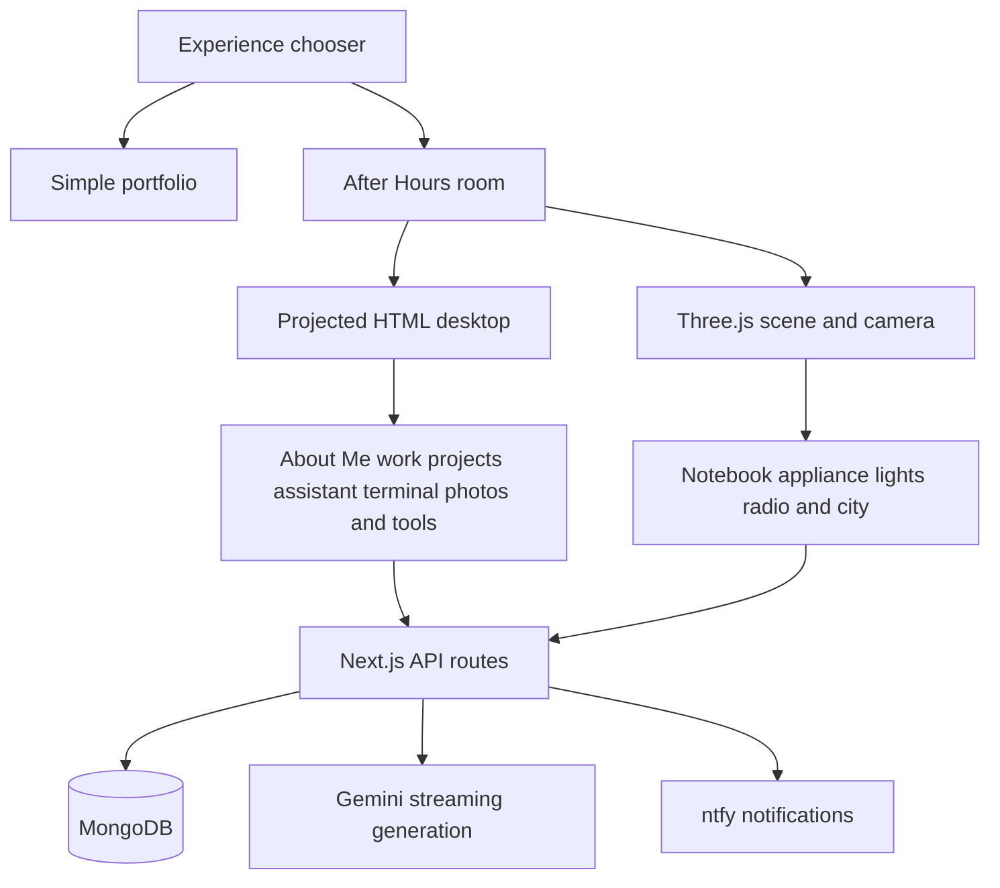
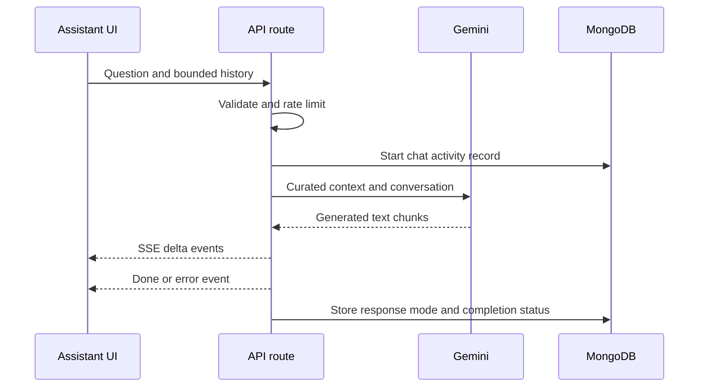

# Portfolio concepts and technical architecture

**Vikram Singh · Technical overview · 16 November 2026**

This portfolio combines a readable professional website with an interactive 3D workspace. Its most distinctive engineering work is the coordination between a Three.js scene, a real HTML desktop, browser input, procedural animation, and server-backed features. The room is an interface to the portfolio: objects lead to work, conversations, drawings, visitor contributions, and small playful interactions.

This document explains the implementation for someone reviewing the project, discussing it in an interview, or extending the code. It describes implemented behavior, explains why the techniques matter, and separates measured results from design intent. Source links point to the relevant files in this repository.

## 1. The product concept

There are two experiences for different visitor needs:

- **Simple** presents work, experience, education, contributions, and contact information in a conventional, readable layout.
- **After Hours** presents a personal workspace that visitors can explore. The monitor contains portfolio applications, the Upliance appliance presents work examples, and the notebook contains technical scratch work and personal doodles.

The landing page makes that choice explicit. Visitors who want information quickly can use Simple; visitors who want to explore can enter the room. This keeps the playful experience from becoming the only route to professional information.

The room also gives interactions a physical meaning. A notebook can be opened and torn, paper can become throwable balls, a radio controls music, a photo frame opens a closer view, and a window leads to a night city. These are connected behaviors rather than isolated hover effects.

**Sources:** [Home](../pages/index.js), [Simple](../pages/simple.js), [After Hours](../pages/after-hours.js), [ProductWorkbench](../components/workbench/ProductWorkbench.js).

## 2. Architecture at a glance

| Layer | Implementation | Responsibility |
| --- | --- | --- |
| Application | Next.js 12 Pages Router and React 18 | Routes, shared providers, UI state, API endpoints |
| Visual styling | CSS Modules and global styles | Responsive layouts, themed cursors, focus states, desktop windows |
| 3D rendering | Three.js and React Three Fiber | Models, cameras, lights, materials, raycasting, animation |
| 2D rendering | HTML, SVG and Canvas 2D | Desktop apps, generated screen textures, notebook artwork, sprites |
| Server data | MongoDB Node driver | Notes, photos, visits, chat activity and admin queries |
| Assistant | Google Generative AI SDK | Streamed answers using curated portfolio context |
| Notifications | Server-side ntfy requests | Best-effort alerts for selected activity |



React coordinates application state and lifecycle. Frame-sensitive work, including camera movement, physics, projection matrices, and material changes, uses refs and frame callbacks instead of updating React state for every rendered frame.

**Sources:** [Dependencies](../package.json), [Application providers](../pages/_app.js), [Scene](../components/workbench/WorkbenchScene.js), [Database connection](../lib/mongodb.js).

## 3. A real desktop inside a 3D monitor

The monitor's desktop is an actual HTML interface, perspective-projected onto a screen in the 3D scene. This is one of the project's most substantial technical details.

The scene converts a desktop coordinate system of 1280 by 780 pixels into the monitor's local screen plane. It then combines the screen's world transform, the camera's inverse world matrix, the projection matrix, and a viewport transform. The resulting matrix is applied to the desktop element through CSS `matrix3d`.

Conceptually:

```text
Desktop pixels
    → monitor local coordinates
    → world coordinates
    → camera coordinates
    → projected viewport coordinates
    → CSS matrix3d
```

As the camera moves, the HTML desktop remains attached to the screen. A cached matrix and viewport size avoid repeating the CSS transform write when the projection has not changed. The implementation also keeps the CSS matrix invertible so browser hit testing continues to work.

This preserves familiar browser capabilities: selectable text, inputs, scrolling, keyboard controls, and React applications. Rebuilding all of those capabilities as 3D meshes would be much more complex.

The HTML desktop is outside the WebGL postprocessing pipeline. Consequently, it has its own approximately one-display-pixel edge mask to soften its perimeter without blurring its contents. The screen projection also determines mobile control sizes, compensating for how large the projected desktop actually appears on the device. When a render-space glasses effect is active, the live HTML surface temporarily hides and reveals the existing Three.js monitor wallpaper underneath. That static fallback participates in the same Pixelated, Crayon, or Sketch pass as the room; opening the monitor removes the glasses and restores the live desktop.

**Why it is interesting:** it joins two rendering systems into one coherent interface, while retaining the strengths of each.

**Sources:** `Monitor` in [WorkbenchScene](../components/workbench/WorkbenchScene.js), [DesktopWorkspace](../components/workbench/DesktopWorkspace.js), [DesktopWindow](../components/workbench/DesktopWindow.js), [Workbench styles](../styles/Workbench.module.css).

## 4. Camera behavior and spatial navigation

The room camera uses OrbitControls for orbiting and zooming. Panning is disabled, and distance, azimuth, and polar-angle limits keep movement within a deliberate range. The general room view targets the original desk-centered point at `[0, 0.2128, -0.51]`.

On desktop, mouse movement reveals a right-edge zoom scale synchronized with the same `6–24` camera-distance boundaries. The home camera distance reads as `1×`; dragging, wheel zoom, and keyboard adjustments update the scale together. Quantized movement produces a short, rate-limited Web Audio dot without attaching audio work to automatic camera transitions.

Focusable room objects also participate in camera zoom. Beginning an inward wheel or trackpad gesture over the monitor, notebook, photo, Upliance, window, sticky notes, or WORK / BUILD board latches that object's stable group-level hover target. The camera aims toward the object's measured world-space bounds while OrbitControls' cursor-relative dolly keeps the pointer ray connected to the gesture. Crossing the focus threshold invokes the same action as clicking the object; lamps, the radio, drawers, glasses, and other toggle-only props deliberately remain click actions.

Before object-directed zoom begins, the camera stores its position and look target. If the visitor stops before committing focus or moves off the target, the tentative move rolls back to that exact zoom over three seconds. Its easing begins at one tenth of linear speed and accelerates, while the line of sight returns separately and smoothly to the desk center. The return is interruptible: a new orbit drag, wheel gesture, touch gesture, or zoom-scale adjustment promotes the current interpolated camera state to the next reference instead of blocking input until the animation finishes. Ordinary outward zoom eases the look target back to the desk over 1.35 seconds rather than snapping it there.

The glossy DOM cursor mirrors this gesture. It glides to the room viewport center while an object aim is active, then glides back to the physical pointer position when the gesture cancels or commits. The physical operating-system pointer cannot be moved by the browser, so hit testing continues at its real location; the latched room target prevents that distinction from dropping focus as the camera reframes. Completed Web Animations release their fill state so normal pointer movement immediately resumes control.

Opening a notebook, monitor, photo, appliance, note, board, or city view temporarily changes the camera's position and look target. Transitions interpolate position, target, and field of view. Returning from a focused object restores the default desk-centered room view.

Focus distances are calculated from the field of view and viewport aspect ratio. For example, a tall mobile viewport needs a different camera distance to fit a screen or notebook spread. The appliance focus is based on its measured display dimensions and surface normal, so the camera approaches the physical panel rather than an arbitrary location.

While a focused view is active, ordinary orbit and inward zoom controls are disabled. An outward mouse-wheel, Chromium trackpad-pinch, Safari gesture, or two-finger touch gesture exits through the same close action used by Escape and the visible back control. These gestures are captured at the workbench boundary so projected HTML surfaces such as the monitor and Upliance display cannot fall through to native browser page zoom. The monitor additionally has a click-outside layer behind its projected screen. Paper aiming also pauses camera movement. Reduced-motion preferences shorten the experience by applying final states without the usual animated movement.

Browser history participates in this model. A same-URL history entry represents an open focused view; pressing Back first exits that view before leaving the portfolio route.

**Why it is interesting:** navigation state, browser history, responsive composition, and physical camera movement agree about where the visitor is.

**Sources:** `Camera` in [WorkbenchScene](../components/workbench/WorkbenchScene.js), [Desktop zoom control](../components/workbench/DesktopZoomControl.js), [Zoom mapping](../components/workbench/cameraZoom.mjs), [Focus history](../components/workbench/useFocusHistory.js), [After Hours transition](../components/AfterHoursTransition.js).

## 5. Asset loading follows what visitors need first

The loading strategy gives the initial room screens priority over decorative and secondary artwork.

1. The shared preloader prepares Simple and the After Hours code.
2. The monitor model, appliance model, appliance display, and actual monitor preview textures load first.
3. Other room assets load afterward, including the firefly GLTF and its referenced binary and textures. Scene readiness waits for the two primary screens before revealing the room through its entry transition, while the home-page readiness card waits for the full tracked room-asset list.
4. The notebook mounts after those screens are ready and loads the supplied doodle images.
5. The appliance showcase SVGs preload automatically after the room assets and notebook images have settled. They load sequentially with idle scheduling and low image fetch priority, without requiring a visit to the appliance.

About Me starts importing in the background when `FirstRoomFrame` signals readiness after four rendered frames, once the monitor and appliance screens are ready. It does not wait for a monitor click. `loadAboutJourney` shares a cached import promise with the dynamically loaded app and clears that promise after a failed request so a later attempt can retry. The same background phase preloads the BUILD / WORK icon images and the 2026 Upliance badge using their final URLs, so opening the timeline can reuse the browser cache instead of revealing the marks progressively. A background failure does not block room entry. This phase does not mount the app, run its decorative introduction, or load the historical portfolio iframes.

Preloading uses the same loader paths and cache keys as the live scene. The home card's progress is based on completed assets, not downloaded bytes. A small image and a large model therefore each count as one completed asset.

The background SVG loader is independent of the appliance's visible work page. Its artwork can become ready before the visitor opens it, but it cannot prevent the appliance's initial model and screen from appearing. Image failures fall back to the text presentation rather than suspending the appliance.

This addresses a common performance mistake: putting every optional texture behind the same loading boundary as the object needed immediately.

**Sources:** [About Me loader](../components/workbench/loadAboutJourney.js), [Scene readiness](../components/workbench/WorkbenchScene.js), [Portfolio app loader](../components/workbench/PortfolioApps.js), [AfterHoursPreload](../components/AfterHoursPreload.js), [PreloadAssets](../components/workbench/PreloadAssets.js), [Upliance](../components/workbench/Upliance.js), [Notebook](../components/workbench/Notebook.js).

## 6. Rendering only the work that changed

### Demand rendering

The scene uses React Three Fiber's `frameloop="demand"`. A new frame is requested when movement or a visual change needs it. Camera damping, active physics, transitions, and other animations continue requesting frames while active; static parts do not need to force a permanent animation loop.

Demand rendering is an optimization opportunity, not a guarantee that the whole room is always idle. An active animation can still keep frames running.

### Cached shadows

Stationary-light shadows are cached. The cache tracks shadow-casting objects, their world transforms, geometry position and index versions, instance transforms, material identity, and relevant light changes. A dirty scene requests a shadow-map refresh; an unchanged scene can reuse the existing result.

This matters because a small visible change can otherwise cause expensive shadow rendering for the rest of the room. The held paper ball is deliberately excluded from shadow casting and receiving while being dragged. Its shadow behavior returns for the thrown ball. The gesture thresholds, launch velocity calculation, and flight simulation remain unchanged.

Firefly meshes cast but do not receive shadows. Because their parent transforms move continuously, they opt into a lower-priority shadow interval of `1/15` second. This preserves moving silhouettes while preventing the three tiny animated actors from forcing every cached shadow map to refresh at display frame rate.

### Rendering quality

The normal postprocessing sequence is scene rendering, bloom, output conversion, and SMAA antialiasing. Three optional glasses passes sit between bloom and output conversion. SMAA is enabled after its lookup textures are ready. Existing render targets resize with the viewport instead of rebuilding the entire pipeline. The general room renders at device pixel ratio `1`; notebook and Upliance close-ups may increase up to `2` for readable detail. The standalone city workspace uses a device-aware cap of `1.5`.

### Render-space glasses

Four separate pairs of glasses sit beside the sticky-note pad. Each is a real selectable room object with its own desk model and matching worn frame:

| Pair | Visual treatment |
| --- | --- |
| Vintage round wire frames | CSS backdrop blur, clipped to the two lenses |
| Chunky pixel frames | A reduced-resolution beauty buffer with nearest sampling plus depth- and normal-derived one-pixel edges |
| Mismatched pastel frames | Quantized, saturated color with layered pastel strokes and geometry-aware outlines |
| Angular monochrome frames | White/grey tonal shading, graphite hatching, image edges, and depth/normal outlines |

The render-space variants extend Three.js's `RenderPixelatedPass`. They render low-resolution beauty, depth, and normal buffers, then composite the result over the incoming full-resolution frame only inside two screen-space lens masks. Pixel frames use a stepped mask; Crayon uses an ellipse; Sketch uses a squarer angular mask. Their saved tuning values live in `lensSettings.js`, while final room positions live in `propPlacement.js`; no runtime tuning controls ship in the room.

Wearing and removing a pair coordinate CSS and WebGL animation. On entry, the non-blur mask begins below the viewport, moves upward, and increases opacity with the physical frame. On removal, it moves and fades downward with the frame before the pass disables. This avoids the effect appearing at screen center before the glasses arrive or remaining behind after the frame leaves. Reduced motion applies the final state immediately.

The photo frame uses an additional Canvas 2D technique: a Sobel edge calculation produces a muted outline version of the supplied photo. Focusing the frame fades toward the original color image.

**Sources:** [Shadow cache](../components/workbench/shadowCache.mjs), [StationaryShadows](../components/workbench/StationaryShadows.js), [Paper rendering](../components/workbench/paperRendering.mjs), `NightEffects` in [CityExterior](../components/workbench/CityExterior.js), [Pixel lens pass](../components/workbench/LensPixelatedPass.js), [Crayon lens pass](../components/workbench/LensCrayonPass.js), [Sketch lens pass](../components/workbench/LensSketchPass.js), [Desk glasses](../components/workbench/DeskGlasses.js), [PhotoFrame](../components/workbench/PhotoFrame.js).

## 7. Responsive hover without sacrificing precise interaction

An object can contain many meshes. Treating each of them as a hover target creates unnecessary ray intersections and can make the hover state churn as the pointer crosses internal parts.

The room now separates two input paths:

| Input | Picking strategy | Purpose |
| --- | --- | --- |
| Unpressed mouse or pen movement | One cached world-space bounding box for each wrapped interactive object | Stable, inexpensive hover |
| Clicks, pressed movement and captured drags | Existing mesh targets and picking rules | Preserve specific actions and gestures |
| Touch | Existing picking path | Preserve touch interaction behavior |

For ordinary hover, a group-level raycast returns the object as a single target and stops recursive traversal into its children. Existing mesh hitbox optimizations remain available for the other input path, and meshes marked for precise picking, such as the tearable page, retain that behavior.

The same bounds support the outline. Static objects do not rebuild their outline bounds every frame. Moving objects check descendant transforms and geometry versions, updating the box only when those values change. Hover state writes and outline visibility changes are guarded against redundant updates.

The cursor and its rotating glow share one translated DOM layer. There is no independent trailing position for the glow; hovering changes its rotation. The paper-throw overlay uses a native cursor. Touch and reduced-motion users do not receive the animated custom cursor.

**Measured evidence:** a local synthetic benchmark of 5,000 hover picks against a 200-mesh object took approximately 89 ms using the previous per-mesh hitboxes and 1 ms using the group hover path. This is an isolated CPU microbenchmark, not a production FPS or end-to-end latency result. The visitor's observed smoothness is useful feedback, but broader device performance still needs browser profiling.

**Sources:** [Room hover](../components/workbench/roomHover.mjs), [InteractiveObject](../components/workbench/InteractiveObject.js), [Mesh hitboxes](../components/workbench/roomHitboxes.mjs), [ThemeCursor](../components/ThemeCursor.js), [Hover regression tests](../tests/room-hover.test.mjs).

## 8. A notebook with physical continuity

The notebook combines generated scratch-work pages, a tear-instruction page, and four supplied doodle images. Screenshot chrome is cropped at render time, and each doodle fills its leaf with its original ruled or white background. Page edges and scraps use colors chosen to match the source paper.

A canvas texture represents a spread. Left and right textures sample separate halves through texture repetition and offsets. Page turns animate a sheet around the binding; the cover has a separate opening and revisit motion.

Tearing deforms a subdivided plane. The deformation progressively releases the binding edge and lifts the paper as the drag progresses. Each page has a deterministic tear profile with different widths and notches, so its remaining scrap is stable and distinct.

A successful tear:

1. Records the removed leaf.
2. Adds a paper ball to a queue.
3. Keeps the notebook open.
4. Reveals the next surviving sheet when one exists.

Page navigation skips runs of removed leaves. The visual turn still includes their remaining strips together with the surviving sheet, maintaining the sense that those pages once existed. The reverse-page lookup accounts for consecutive tears. When the final visible sheet has been removed, the backing uses the notebook cover's muted green rather than displaying a stale page image.

The notebook's open state and selected page are stored locally. The torn-page list and ball inventory are React state for the current mounted experience; they should not be described as durable cross-device storage.

**Why it is interesting:** the visual model and the interaction state remain consistent across tearing, backward navigation, and multiple missing leaves.

**Sources:** [Notebook](../components/workbench/Notebook.js), [Page data](../components/workbench/notebookPages.js), [Drawing code](../components/workbench/drawNotebook.js), [Paper geometry and navigation](../components/workbench/notebookPaper.mjs), [Notebook tests](../tests/notebook-paper.test.mjs).

## 9. Paper balls and lightweight physics

A torn sheet becomes an inventory item. The visitor selects a ball, drags it in the aiming overlay, and releases a flick. The implementation samples recent pointer movement to calculate a screen-relative velocity, then transforms the launch direction through the camera's orientation into world space.

The flight simulation is custom, lightweight physics rather than a general rigid-body engine. It applies gravity, drag, desk or floor contact, wall bounds, bounce damping, friction, and velocity-based rotation. Bounded substeps reduce tunnelling during slower frames. Balls eventually enter a sleeping state when movement is small enough.

Thrown balls stay mounted, retaining their resting positions. The next inventory item can be used afterward. During aiming, pointer capture keeps the drag connected to the overlay even if the mouse leaves the original ball location.

The drag performance change targets rendering cost: the held ball does not invalidate stationary shadow maps. Once thrown, its normal shadow behavior is restored. This avoids changing the established throwing mechanic to address a rendering problem.

**Sources:** [PaperFlick](../components/workbench/PaperFlick.js), [PaperBalls](../components/workbench/PaperBalls.js), [Paper inventory state](../components/workbench/paperInventoryState.mjs), [Shadow regression test](../tests/paper-rendering.test.mjs).

## 10. Upliance as an interactive work presentation

The appliance is an optimized CAD-derived model with preserved semantic parts. Its lid remains a separate assembly, light guides can change emission, and the display is replaced with a controlled screen surface.

Hovering opens the lid and activates the lights and display. Focusing the appliance keeps it awake and presents portfolio work on the physical screen. The work pages combine text and SVG artwork in generated canvas textures. Frame sequences advance after camera arrival, pause their advancement when the document is hidden, and respect reduced motion.

The LED ring uses 56 instances rather than 56 separately managed draw objects. The HTML interaction surface is projected onto the physical display, allowing clicks on either side of the screen to change pages. Keyboard arrows also navigate, and clicking outside or pressing Escape returns to the desk.

The appliance illustrates portfolio work; it is not connected to a live cooking device or recipe backend.

### Model optimization evidence

The asset documentation records a reduction from approximately 1,946,197 triangles to 186,504, about a 90.4% reduction. The interactive GLB is documented as 4,491,216 bytes. Optimization combines compatible parts, simplifies geometry, removes unused data, and quantizes attributes while retaining the nodes needed for animation. It does not require an external runtime decoder.

The city and other room assets also use optimized textures. Color maps use lossy WebP where appropriate; data maps use lossless encoding, and resized normal maps are renormalized. Source files, attribution, and optimization scripts are retained. These are documented asset-pipeline figures, not claims about current network transfer time.

**Sources:** [Upliance](../components/workbench/Upliance.js), [Work content](../components/workbench/uplianceWork.js), [Asset documentation](../public/models/README.md), [Appliance optimizer](../scripts/optimize-upliance.mjs), [City optimizer](../scripts/optimize-city.cjs), [Room optimizer](../scripts/optimize-room.cjs).

## 11. The desktop is a small application environment

The projected desktop has window state, application focus, minimize and close behavior, dragging, resizing, and taskbar controls. Minimized windows retain their component state; closing a window removes it. Mobile layouts use larger controls and different window geometry rather than simply shrinking desktop controls.

The applications include work and project information, an AI assistant, a terminal, photos, task management, and asset credits. External shortcuts open the supplied professional profiles.

The terminal is a browser simulation with a session-only virtual filesystem, command history, completion, path navigation, and supported command parsing. Commands such as `ping` and `sudo` are simulated. It cannot execute host shell commands or access a visitor's files. App listings such as `ps` and `top` reflect open portfolio windows rather than invented operating-system CPU metrics.

The mascot adds stateful feedback: waking, sleeping, walking, exercise, music poses, and hints. Its hint rotation covers the four lens treatments, desktop zoom scale, and firefly/light choreography alongside room objects and apps. Mobile hints are measured with the pixel font and paginated into the available space. They overlay the desktop without resizing the shortcut grid when opened. Its per-letter synthetic voice now plays at 60% of its previous level.

**Sources:** [DesktopWorkspace](../components/workbench/DesktopWorkspace.js), [DesktopWindow](../components/workbench/DesktopWindow.js), [Terminal engine](../components/workbench/terminalEngine.mjs), [TaskManager](../components/workbench/TaskManager.js), [DesktopMascot](../components/workbench/DesktopMascot.js), [Mascot behavior](../components/workbench/mascotBehavior.mjs), [Mascot voice hook](../components/workbench/useMascotVoice.js), [Voice synthesis](../components/workbench/mascotVoice.mjs).

### About Me: a pixel room through time

About Me fills the monitor with an SVG desk scene and a compact year selector. Its artwork uses stepped paths, supplied profile and internship logos, CSS Modules, and the bundled pixel font. It adds no rendering library or sprite-sheet dependency. A decorative loading bar and opening zoom introduce the room; the bar is timed presentation, not download progress.

Each logical SVG item is positioned through `pixelRoomLayout.mjs` on the shared 480 × 240 scene. The `2021`, `2025`, and `2026` sections expose copy-paste-friendly `{ x, y, width, height }` entries for the window, desk, lamp, notebook, computer, WORK / BUILD board, radio, chair, and year-specific props. `PixelDeskScene` applies the same transform to the art and derives interactive hotspot bounds from it, so repositioning or resizing an item does not require editing path data or manually realigning its button. Omitting an item from a year hides it. The source bounds live separately in `PIXEL_ITEM_BOUNDS` and normally do not need art-direction edits.

Appending `?pixel-editor=1` to the portfolio URL enables the owner layout editor without exposing controls in the ordinary experience. The editor supports SVG-item or dropdown selection, live `x`, `y`, `width`, and `height` sliders with numeric inputs, a selection outline, per-year/all-year reset, and a copy-ready JSON block containing every year. Drafts persist locally under `pixel-room-layout-draft-v3`, so a refresh does not discard unfinished placement work. Interactive object clicks select their owning item while editor mode is active rather than triggering the room action.

Example final-position handoff:

```js
'2025': {
  lamp: { x: 121, y: 113, width: 54, height: 53 },
  notebook: { x: 156, y: 148, width: 51, height: 24 },
  'work-board': { x: 308, y: 92, width: 57, height: 69 },
}
```

The timeline has three major stops, represented internally as month offsets `2`, `56`, and `60`. Previous/next buttons and arrow keys cycle through **2021 → 2025 → 2026 → 2021**, including reverse wrapping. Animation direction follows the selected arrow even when the year wraps. Navigation is guarded during the introduction and active transition.

| Chapter | Scene and content |
| --- | --- |
| 2021 | The shared monitor, chair, keyboard, left-drawer desk and toggleable desk lamp, plus a notebook, daylight window and chalk height mark at 5′2″. The notebook presents school and college beginnings, entrance exams, Pokémon modding, and doodles. |
| 2025 | The same monitor, chair, keyboard, drawer desk, window, lamp and notebook positions. The WORK / BUILD board sits separately at `{ x: 308, y: 92, width: 57, height: 69 }`. The plant and radio use their 2026 placements, the window is rainy, and the height mark reads 5′4″. |
| 2026 | The same persistent furniture and notebook/lamp positions plus a night window, floor-standing plant, hoop, desk radio, sticky notes, ceiling light above upliance, a small generic faceless portrait replacing the WORK / BUILD board, a supplied Upliance logo badge on the appliance, and a 5′6″ mark. Object placement follows the corresponding 3D room. |

`Presence` retains departing year-specific SVG groups until the half-second transition finishes. CSS keyframes scale those items through intermediate pop-in and pop-out shapes, with staggered arrivals contained within the same 500 ms interval. The WORK / BUILD board is logically limited to 2025, so it now receives the same pop-out treatment when leaving that chapter instead of disappearing after the layout swap. The monitor, chair, keyboard, drawer desk, lamp and notebook reuse the same positions without presence animations. Window weather crossfades with the year. Reduced motion skips these transitions and the introduction. SVG artwork is paired with labelled HTML buttons positioned over interactive objects; hotspot coordinates follow their owning layout items. The pixel lamp's lit state follows the physical desk lamp, and its hotspot invokes the registered 3D lamp action in every year. Removing the WORK / BUILD item from 2026 also removes its associated historical-board hotspots.

The 2021 and 2025 monitors embed separately deployed historical portfolios, with chapter notes beside them and an external full-page link. Their URLs and Git history references are maintained in `portfolioHistory.js`. Embedding still depends on the remote deployment allowing framing and public access; the parent app cannot override a remote framing policy. The 2026 monitor instead performs a 1.2-second zoom, closes About Me, and returns to the real 3D room—the current portfolio.

The early notebooks open into a single illustrated two-page spread rather than a multi-page reader. LeetCode opens a zoom followed by a dashboard of supplied screenshot values, including 534 solved problems and a contest rating of 1,471. GitHub displays the shared contribution list for Kestra, MCPJam Inspector, and Claude Agent SDK for Python. Both views identify saved data: they do not fetch live statistics or claim the numbers and contribution statuses are verified snapshots of the selected year.

The window's `WindowBackContext` lets an open detail register a back action. The window × and Escape return from details before closing About Me; focus returns to the selected room object. In 2026, the notebook and upliance hand control to their physical 3D counterparts while preserving the mounted app for the return trip. Radio and ceiling-light clicks call registered room actions, and their displayed states follow the real room controls.

**Sources:** [AboutJourney](../components/workbench/AboutJourney.js), [PixelDeskScene](../components/workbench/PixelDeskScene.js), [Timeline and object data](../components/workbench/journeyTimeline.mjs), [JourneyNotebook](../components/workbench/JourneyNotebook.js), [LeetCodeSnapshot](../components/workbench/LeetCodeSnapshot.js), [Contributions](../lib/contributions.js), [Portfolio history](../components/workbench/portfolioHistory.js), [Current portfolio zoom](../components/workbench/InceptionMonitor.js), [Journey styles](../styles/AboutJourney.module.css).

## 12. Lighting sound and smaller physical interactions

The hanging light has a simulated rope with connected segments and a moving fixture. Dragging changes its motion, and the simulation can settle to sleep. Instanced cord segments visualize the changing rope without creating a new object for each segment on every frame.

The radio starts off, including when entering from Home. Playback begins directly inside the radio's click, tap, or keyboard activation so it follows browser interaction rules. Leaving the room disposes playback resources. Radio toggles also produce a short static effect using Web Audio. The looped music level is set independently and is 50% below its previous room mix.

Three rigged fireflies add a small procedural story to the room. Each instance is a skeleton-safe clone of the same low-poly GLTF, with independent wing speed, route pacing, hover frequency, animation timing, and formation offsets. The imported model is normalized to a maximum dimension of `0.1232` scene units. Its geometry is already approximately 1,900 triangles, so optimization preserves the rig rather than decimating it. The two largest base-color maps were reduced from 2048×2048 to 512×512, bringing the complete local model directory from approximately 3.2 MB to 1 MB. These are asset-directory measurements, not network-transfer timings.

Their 36.5-second choreography uses five-second travel phases but limits the stop at the end of the monitor to 1.5 seconds. The group begins above the plant, crosses the desk, and circles the monitor before two continue to Upliance while the third travels to the chair, switches from its flight clip to its landed-idle clip, and walks a small three-second path across the seat. At Upliance, one of the pair flies upward toward the outside edge of the ceiling-light shade rather than its central cord. The collision uses a fast ease-out trajectory and a temporary body roll to throw the insect backward, applies an impulse to the existing rope simulation, and produces two unequal extended flicker dips across the bulb material, spotlight, and fill light before the insect returns to its companion. The chair firefly then takes a slower seven-second route toward the radio while the pair begins its five-second return, allowing the three to reunite there before returning to the plant. Catmull–Rom curves provide the larger paths. Per-firefly nonlinear pace offsets preserve common departure and arrival points while letting individuals lead or trail in between; distinct wing speeds and sinusoidal hover frequencies further prevent synchronized-looking motion. Reduced-motion mode leaves the group stationary near the plant.

Their model meshes are cast-only shadow participants: `castShadow` is enabled while `receiveShadow` remains disabled. The shared stationary-light cache samples their continuous movement at 15 FPS and still forces a final refresh after motion settles.

Each firefly combines the model's emissive material with a small tone-mapping-independent emissive core and a local point light. The existing bloom pass turns the core into a soft halo, while the point light lets the insects subtly illuminate nearby surfaces throughout the route. Their bodies do not receive shadows, preserving their glow and local illumination. Because this is a continuously active animation, it requests frames from the otherwise demand-rendered scene while enabled. The model is **Lowpoly Firefly** by Caledhril, licensed under CC BY 4.0; its attribution is also exposed in the desktop Credits application.

Other interactions include four directly wearable glasses pairs on the desktop, a city view with a flying aircraft, and generated paper surfaces for notes. These details demonstrate lifecycle management: animations, render targets, audio, streams, and event listeners need cleanup as well as startup.

**Sources:** [CeilingLight](../components/workbench/CeilingLight.js), [Radio](../components/workbench/Radio.js), [Fireflies](../components/workbench/Fireflies.js), [Firefly license](../public/models/firefly/license.txt), [Asset credits](../components/workbench/AssetCredits.js), [DeskGlasses](../components/workbench/DeskGlasses.js), [GlassesOverlay](../components/workbench/GlassesOverlay.js), [FlyingPlane](../components/workbench/FlyingPlane.js).

## 13. A streamed portfolio assistant

The assistant is available through the website UI and the desktop app. The browser sends a question and a bounded conversation history to `/api/about`. The server combines a system instruction, curated résumé text, and a maintained repository description before requesting streamed generation.



The response uses Server-Sent Events with `delta`, `done`, and `error` messages. The browser reconstructs events across network chunks rather than assuming each network read contains a complete message. Disconnects abort provider work, and timeout handling bounds request lifetime.

If generation fails before any text arrives, the server can provide a labelled curated résumé answer. A failure after partial output produces an interruption message instead of silently replacing the existing reply.

Important implementation limits:

- The endpoint uses curated text context, not a vector database or live repository retrieval.
- Prompt instructions constrain intended behavior but are not a guaranteed security boundary.
- The model identifier can be configured server-side; naming a configured model does not prove provider availability.
- Rate limiting is process-local, not distributed across all server instances.
- The visual assistant-journey replay is illustrative, not live model-internal telemetry.
- The UI conversation is not restored from server history after a reload, even though chat activity is recorded server-side.

**Sources:** [AboutChat](../components/AboutChat.js), [Assistant API](../pages/api/about.js), [Profile knowledge](../lib/profile.js), [Curated context](../lib/assistant-context.js), [Chat activity](../lib/chat-activity.js), [AssistantJourney](../components/AssistantJourney.js).

## 14. Shared notes photos and ownership

### Notes on the wall

Wall notes are real shared data backed by MongoDB. Visitors write text on a projected paper editor, then place it on the room wall. The editor's projection uses the sticky-note pad's final position, rotation, and scale, so the HTML writing surface and its 3D source remain aligned. Its hover wrapper updates world bounds when the pad transform changes. Moving a wall note intersects the pointer ray with the wall plane and clamps the resulting coordinates to the allowed area.

Ownership uses a browser token whose hash is stored with the record. Read responses expose whether that browser can edit a note, without returning the stored ownership hash. Mutations filter by both note ID and owner hash. Repeated creates use the same ID and insert-only fields, preventing duplicate notes during retries.

This is browser ownership, not a user account system. Clearing the browser token loses those editing rights. Polling refreshes shared state while respecting visibility and editing activity.

### Photos and camera capture

The Photos app supports image selection and browser-camera capture. A captured image is previewed before explicit sharing. Camera tracks are stopped when the relevant view is no longer active. The client produces bounded JPEG images and thumbnails; the server validates encoded size, JPEG structure, and dimensions before storing binary data.

The gallery uses cursor pagination with creation time and ID, returning batches of 40. Browser ownership controls deletion. The API validates requests, bounds writes, and avoids exposing owner hashes in public records.

**Sources:** [StickyNotes](../components/workbench/StickyNotes.js), [Note projection](../components/workbench/NoteProjection.js), [Notes hook](../components/workbench/useStickyNotes.js), [Notes API](../pages/api/wall-notes.js), [Photos](../components/workbench/Photos.js), [Photos API](../pages/api/photos.js), [Database connection](../lib/mongodb.js).

## 15. Analytics notifications and the admin boundary

The portfolio tracks semantic interactions, route views, visit duration, and visible-tab active time. Events are batched, and page-exit beacons improve the chance of sending final activity. Server-side records deduplicate batches and merge cumulative durations rather than simply adding every retry.

About Me uses this same event pipeline: `journey_open`, `journey_year`, `journey_object`, `journey_back`, `journey_link`, and `journey_enter_portfolio`. Targets identify the chapter, object, year transition, or contribution project. Link tracking covers the archive full-page links and GitHub/detail links wired in `AboutJourney`; it does not observe navigation inside the external iframes. Object events record requested actions, not proof that a remote page loaded or a physical transition completed.

These metrics have limits: an IP address is not a unique person, visible-tab time is not guaranteed attention, and beacon delivery is not guaranteed. Interaction analytics avoid typed arguments and message contents; chat questions and responses are stored separately as chat activity. The privacy page describes the data practices.

Notifications are server-side, best-effort ntfy requests with a timeout. A notification failure does not turn a successful data write into a failed upload. There is no durable retry queue in the current notification helper.

There is also an authenticated admin data path, separate from simulated terminal privileges. Password verification uses scrypt and constant-time comparison. Sessions use an HMAC-signed, expiring cookie with HttpOnly and SameSite restrictions, and Secure in production. Admin data queries authenticate first, use an allowlist of collections, paginate results, and omit selected large or ownership fields.

The terminal-launched admin console provides dataset-wide observability rather than page-local table controls. Each collection exposes an explicit server-side sort allowlist, ascending or descending order, an 80-character escaped text search across collection-specific fields, refresh timestamps, result counts, and pagination. Visitor activity remains grouped by IP with aggregate visits, active time, and interaction counts; matching visits can be searched before grouping, then expanded into paginated per-IP timelines. The API maps public sort names to fixed MongoDB fields and constructs escaped literal regular expressions, preventing arbitrary field selection or operator injection.

This is an important distinction: simulated `sudo` does not grant access to server data. The real admin APIs enforce their own authentication.

**Sources:** [VisitorAnalytics](../components/VisitorAnalytics.js), [Client analytics](../lib/visitor-analytics.js), [Visit API](../pages/api/visit.js), [Notifications](../lib/photo-notifications.js), [Admin authentication](../lib/admin-auth.js), [Admin session API](../pages/api/admin/session.js), [Admin data API](../pages/api/admin/data.js), [Admin console](../components/workbench/AdminView.js), [Visitor drill-down](../components/workbench/AdminVisitors.js), [Admin styles](../styles/AdminView.module.css), [Privacy page](../pages/privacy.js).

## 16. Accessibility and responsive interaction

The experience includes keyboard selection for room objects, Enter activation, Escape exits, visible focus treatment, and semantic application controls. The persistent bottom room status shows hover or navigation context without repeating the former visible Enter-activation tip; keyboard instructions remain in the room's accessible label. Notebook text has a screen-reader representation rather than relying entirely on canvas textures. Hidden or inactive desktop regions use accessibility and interaction attributes to avoid exposing the wrong face or screen as active.

Touch interaction uses its own camera mappings and larger controls. Reduced-motion preferences affect camera movement, animation, and custom cursor behavior.

These are implemented accommodations, not evidence of a completed accessibility audit. The spatial room still needs keyboard, screen-reader, contrast, zoom, and mobile-device testing. The Simple experience provides a conventional route to the same professional information.

## 17. Verification and technical claims

The repository contains targeted tests for the virtual terminal, wall-note validation, notebook navigation and tearing, held-paper shadow behavior, and hover picking and bounds caching.

```bash
npm run lint
node --test tests/*.test.mjs
npm run build
```

Lint checks source issues; unit tests exercise specific behavior; a build checks compilation and page generation. None of those alone prove smooth browser rendering or successful production database and provider connections.

The recent hover tests verify that coarse hover avoids child mesh picks while clicks retain their original targets. Bounds tests check idle reuse, movement, geometry deformation, and removed children. The held-paper test verifies that dragging preserves cached shadows and that thrown-paper movement invalidates them again.

The About Me implementation and circular-timeline update passed targeted ESLint and Git whitespace checks. No build or browser checks were run for those changes; visual transitions, iframe availability, and runtime performance remain owner-verified rather than established by those source checks.

For performance validation, compare the same scene, device, viewport, cache state, and interaction before and after a change. Record frame timing and main-thread work during hover and dragging, and inspect network requests during initial loading. The synthetic hover result above should not be presented as a site-wide speedup.

The curated assistant context and older asset notes can lag implementation changes. For current behavior, the component and API source files linked here are the more precise reference.

## 18. Technical details worth highlighting

For a portfolio walkthrough or interview, the strongest explanations connect a constraint to a concrete solution:

1. **A usable desktop inside 3D:** projection matrices attach real HTML apps to a physical monitor while retaining browser input and accessibility features.
2. **Fast hover with precise actions:** separate coarse hover bounds from click and drag picking, rather than reducing precision everywhere.
3. **Rendering with awareness of change:** demand frames and shadow invalidation avoid work that does not affect the current image.
4. **A complete paper interaction:** page deformation, missing-leaf navigation, deterministic scraps, inventory, and physics agree about what happened to each sheet.
5. **An interactive CAD asset:** a large assembly is optimized while preserving meaningful parts for lid, light, and display behavior.
6. **Loading based on perceived importance:** initial screens arrive before secondary art, while optional SVGs still become ready automatically in the background.
7. **Real backend features with explicit boundaries:** shared notes and photos, streamed AI responses, authenticated admin views, and clearly labelled terminal simulation coexist without pretending to be the same kind of capability.
8. **A timeline connected to the real room:** SVG object transitions, archived portfolio embeds, preserved app state, and physical-object callbacks turn biography into navigation.
9. **Lifecycle discipline:** textures, geometries, pointer capture, event listeners, timers, audio, camera streams, and provider requests have explicit cleanup paths.

The value of the project is the coordination across these systems. A convincing explanation should show how a visitor action travels through input handling, application state, rendering, and persistence, then explain the tradeoffs made to keep that interaction understandable and responsive.

## 19. City, mobile rendering, and mascot updates — November 9, 2026

- `/city` provides a dedicated workspace for the shared city model, window-camera view, orbit inspection, and placement, lighting, and cloud controls. The room uses the same city component. The original window camera remains at `[-3.2, 2.3, -2.1]`, looking toward `[-8.1, 4.7, -14]`, with a 45° field of view.
- `/temp` extends that workspace into a noindex three-year editor. 2026, 2025, and 2021 keep independent slider state in browser localStorage. The panel edits and copies all view, camera, fog, lighting, postprocessing, city rotation, city tilt, and non-uniform building-height values as a single JSON object. `CITY_SETTINGS_BY_YEAR` now contains the owner-approved block and drives production; each editor tab resets to its corresponding committed values while still allowing another calibration pass.
- Layered procedural clouds hide the city base. The saved fog settings are height `1.6`, thickness `2.4`, spread `73`, and density `0.65`. A world-space fade from Z `-5.5` to `-3.5`, followed by clipping, keeps clouds behind the room window regardless of city scale or rotation.
- Notebook turning leaves no longer cast or receive shadows, avoiding artifacts between their closely spaced faces. Notebook and Upliance close-ups use device pixel ratio up to 2, with matching postprocessing resolution. Upliance artwork textures also use supported anisotropic filtering, capped at 8.
- The mascot reveals hints character by character with a small synthetic alphabet voice. A–Z produce short sounds; spaces, digits, and punctuation remain silent, with extra timing pauses after punctuation. Audio unlocks on a mascot click, stops on dismissal or hidden/inactive views, and is disposed on unmount. Reduced-motion mode reveals text immediately without chatter. Final amplitude is 9% of the initial prototype. Mobile hints have no rectangular background or box shadow.
- The approved mobile hoop placement is `x: -1.85`, `y: 2.85`, `z: -1.473`, `rotation: -90`, `size: 0.75`. The renderer, rim scoring, and backboard collision all use `hoopForWidth`; the desktop placement is unchanged. Temporary mobile placement sliders have been removed.

Visual and listening verification is handled by the owner; no browser checks were performed for these changes. Lint and targeted notebook, artwork, shadow-motion, and basketball tests provide code-level validation.

## 20. Planned: synchronize the About Me timeline with the physical room

**Status: implementation in progress.** The shared year manifest, lifted `roomYear`, desktop callback path, active-object gating, persistent furniture policy, synchronized desk lamp and notebook placement, interactive 2025 WORK / BUILD board, 2026 pixel photo frame, 2021 radio fade, near-black room swap, and year-specific window/light treatments are implemented. Selecting 2021, 2025, or 2026 in the monitor's About Me timeline selects that physical 3D room too. The initial room remains 2026. At a year request, the physical room darkens behind the still-readable projected monitor, commits the prop and atmosphere swap at peak darkness, then reveals the target room. Leaving About Me therefore exposes the selected year without a second change. The monitor, computer, chair, keyboard, drawer desk, desk lamp, room shell, projection, and camera remain mounted. Priority loading and pending/error UI for future external period assets remain planned.

### Ownership and scene definition

`ProductWorkbench` owns the committed `roomYear` (`2026` initially). It passes `roomYear` and `onRequestYear` through `DesktopWorkspace` and `PortfolioApps` to `AboutJourney`, and passes `roomYear` to `WorkbenchScene`. About Me keeps its half-second SVG transition state locally and initializes its stop from the committed room year. The shared manifest defines the three stops, month mapping, visible actions, prop groups, and future asset slots. Because the implemented older-year props are procedural and require no asynchronous load, the commit is delayed only until the blackout reaches peak opacity. Readiness-gated commit remains the policy for future external assets.

| Layer | 2021 | 2025 | 2026 |
| --- | --- | --- | --- |
| Persistent core | Room shell, drawer desk, window, notebook, toggleable desk lamp, monitor/computer, chair, keyboard, projection and camera | Same core | Same core |
| Period props | Shared 3D city and plane with sunrise lighting | Shared radio and plant, animated rain and drifting layered 2.5D rain clouds over the shared city and plane, interactive four-card WORK / BUILD board | Shared city and plane beneath an illuminated crescent moon, current upliance, hoop, radio, fireflies, plant, ceiling light, sticky notes, glasses, paper balls, pixel photo frame and other current props |
| Screen content | Historical portfolio and 2021 About Me art | Historical portfolio and 2025 About Me art | Current desktop and 2026 About Me art |

The monitor/computer, chair, keyboard and drawer desk intentionally do not vary by year in either representation. The same desk-lamp graphic, physical lamp model, and 2D notebook/lamp coordinates persist too. The physical window also keeps one city model and aircraft route mounted across all years, but its transform, camera framing, fog, and lighting now come from the approved per-year settings map. Material emissive strength, city lights, procedural fog, room lighting, glass overlays and aircraft fill shift from warm 2021 sunrise to cool 2025 rain to 2026 night. The complete window assembly is interior-only: its frame, center panes, sill, glass tint, and glass-local weather hide when exterior mode starts, preventing the narrow 2021 camera from being blocked by mullions. The 2025 interior glass keeps only an overcast tint, animated streaks moving at 1.3 times their original speed, and nine sparse two-layer droplets that make the glass surface readable; the former painted cloud strips are removed. Camera transition completion now emits a separate `outsideArrived` signal. Camera-relative exterior rain, sun glare, and aircraft motion use that settled signal rather than the initial window click, so none appears during the 1.45-second zoom. The former flat 2021 sun drawing is removed: the shared exterior now contains a world-space sun whose one-unit diameter approximately matches the normalized aircraft. Three's built-in `Lensflare` is intentionally not used because its temporary magenta framebuffer occlusion probe can be restored incorrectly through the floating-point postprocessing target, producing the observed cyan/magenta bullseye against clear sky. A depth-tested ivory-to-gold halo and explicit sun ring are joined by six low-opacity warm camera-axis sprites. Their factors extend past the opposite screen axis and use both glow and ring textures, restoring the longer optical trail without introducing another framebuffer pass. The sun mesh remains depth-tested in the shared world, while all halo, ring, and camera-axis glare sprites mount only in the settled exterior view so they cannot shine through the room walls. The 2025 sky alternates the authored transparent `rain-cloud-bank.png` and `rain-cloud-wisp.png` assets across four formations. Each formation stacks offset shadow, full-color body, additive highlight, and underside copies at slightly different depths, giving the silhouettes volume and parallax while retaining the supplied reference's asymmetric lobes and long wisps. They drift and bob slowly across the shared city and freeze under reduced motion. The 2026 moon is a larger alpha-cut illuminated crescent with a restrained cool halo and point light. The two rain fields never overlap the desk or the transition. The 2025 WORK / BUILD board is independent at its supplied 2D position. Its 3D counterpart is a freestanding framed, textured four-card board resting on the desk immediately to the monitor's right. Hover and keyboard focus share the normal room affordances; activation opens a board-specific physical camera close-up rather than focusing the monitor. Click-outside or Escape returns to the stored room viewpoint. The 2026 2D scene omits that board and its hotspots, using a separately positionable small photo frame in the area instead. The plant remains mounted in 2025 and 2026. No substitute historical computer or chair is planned. A separate year manifest keeps future period additions as data changes rather than scene rewrites.

`notebookPagesForYear` gives the shared physical notebook three year-specific opening spreads without changing its model or page mechanics. The 2021 set transcribes the 2D journey notebook's Mumbai-to-Chennai education path, VITEEE rank, abstract achievement marks, Pokémon-modding creature/Pokéball/handheld drawing, and map-to-new-idea sketch. The 2025 set transcribes graduation and CGPA notes, campus-first Hash Code result, LeetCode/Linux/Git practice, client-service-storage diagram, and the 20+ Vercel/project build log. The 2026 set keeps the existing Upliance, Fibonacci and agent-harness pages. Every set contains exactly eight entries: three year pages, the tear instruction at index 3, and the same four image-backed doodle leaves at indices 4–7. Page navigation, screen-reader content, torn-page inventory and saved localStorage page therefore remain aligned across a year change.

### State and interaction policy

Changing years should reset *ephemeral physical interaction* state: cancel paper aiming and in-flight balls, clear celebration and hover/keyboard target, remove worn glasses, close an open physical focus or sticky-note editor, and settle the hanging light. The radio remains mounted and interactive in 2025 and 2026. Entering 2021 fades active music over roughly half a second before pausing it and hiding the radio. The existing notebook page and torn-page inventory, sticky-note data, and open desktop windows should be retained for the current visit; they can be used again when their objects return. Do not clear the notebook's existing localStorage entry. If a year change starts while About Me is on the monitor, close only incompatible physical overlays and keep the monitor camera and About Me window open. The shared projection anchor and interaction plane remain stable because the monitor itself is persistent.

Gate scene actions from the manifest: the keyboard object list, hover targets, room action registry, camera focus destinations, and click handlers must not point to hidden props. When an object disappears or becomes inactive, its registration cleanup removes its action. The 2D timeline can continue showing its historical detail views; physical handoff is limited to objects enabled by the active manifest. The 2025 radio is the first older-year handoff. The current historical portfolio iframes remain on demand, not part of room asset loading.

### Loading and transition sequence

1. Keep the first visit focused on the 2026 critical path. Load the physical monitor, initial display and only the models needed for the first visible 2026 frame. Move optional 2026 props out of the current global `PreloadAssets` list; the city already streams after the main room. Keep the radio audio file on its existing entry path only if initial progress is intended to include it; otherwise fetch it on first radio interaction and make that change explicit in the progress UI.
2. Only after the visitor enters the monitor and About Me is active, schedule a low-priority prefetch of the nearest other year; focus on its year control is another intent signal. Mere background import or mounting of About Me must not start this prefetch. A deliberate year click takes priority over idle prefetch. Load that year's manifest URLs using the *same* GLTF and texture loader/cache keys as the mounted components. GLTF dependencies such as `.bin` and textures must be included by the loader, not counted as independent user-facing scene milestones.
3. On a year request, retain the current room and 2D selected stop while the target's minimum visible asset set loads. Show a small in-context loading state on the timeline; do not reuse the homepage entry progress bar. Ignore stale completions using a monotonically increasing request ID when users rapidly request different years. If loading fails, keep the old physical year, restore the old 2D selection, and offer Retry.
4. After assets and their first shader compilation are ready, stage the target group in the existing Canvas. The implemented procedural path darkens the physical room over 340 ms beneath the projected monitor, commits `roomYear` at peak darkness, holds briefly, and reveals over 600 ms. It does not remount the Canvas, camera, projected desktop, room shell, or shared notebook state. Window artwork, lighting, physical props, action registration, and radio visibility update at the concealed commit. Reduced motion makes the commit immediate. A polite status region announces the target year. Future asynchronous assets should join this same commit point after readiness succeeds.
5. Keep the previous year's parsed assets in the browser/Three loader cache for quick back-and-forth, but unmount its meshes and release year-local animation, audio, listeners, timers, and temporary render targets. Do not call `useLoader.clear` or dispose shared cached geometry/materials during ordinary switches. Bound memory by avoiding prefetch of all years at once; measure cache retention and only add explicit eviction if profiling shows a real memory problem.

Loading starts from an explicit intent or idle hint, not from merely landing on the page. Dynamic imports can split large year-specific React components; separate manifests and `Suspense` boundaries prevent an optional year from blocking 2026 entry. The homepage readiness count covers only the entry-critical set and reaches completion even if 2021/2025 assets have never been requested. A later timeline change has its own ready/error state. Browser HTTP caching and the Three loader cache make revisits fast within the same session; any longer-term guarantee depends on deployment cache headers.

### Implementation order and checks

1. **Implemented for current procedural props:** define the shared year manifest and audit which current objects are year-specific. Future external models can extend the manifest asset slots.
2. **Implemented for the synchronous first slice:** lift timeline state and wire the callback through the desktop, including reopen/back behavior and the historical monitor view.
3. **Implemented for the current art set:** split the room into persistent core and keyed year prop groups. Persistent furniture stays mounted, the plant and radio span 2025/2026, 2025 has a functional four-card WORK / BUILD board, 2021 fades and hides the radio, and keyboard/click actions are gated against the active manifest.
4. **Implemented for procedural switching:** conceal the physical swap behind a monitor-preserving near-black transition, with daylight/rain/night atmosphere changes and reduced-motion fallback. Build the priority loader, in-context pending/error UI, and stale-request guard when external year assets are introduced.
5. Review cold-load network requests, initial progress completion, switching and rapid reversal, missing-asset fallback, focus and audio cleanup, reduced motion, mobile projection, and GPU memory on a lower-end device. The intended checks are behavioral acceptance criteria; no performance or visual result is claimed here.

**Primary change points:** [AboutJourney](../components/workbench/AboutJourney.js), [Room year manifest](../components/workbench/roomYears.mjs), [2D item layout](../components/workbench/pixelRoomLayout.mjs), [Timeline data](../components/workbench/journeyTimeline.mjs), [DesktopWorkspace](../components/workbench/DesktopWorkspace.js), [PortfolioApps](../components/workbench/PortfolioApps.js), [ProductWorkbench](../components/workbench/ProductWorkbench.js), [WorkbenchScene](../components/workbench/WorkbenchScene.js), [3D WORK / BUILD board](../components/workbench/WorkBuildBoard.js), [Room shell and window weather](../components/workbench/CozyRoom.js), [PreloadAssets](../components/workbench/PreloadAssets.js), [Model inventory](../public/models/README.md).
