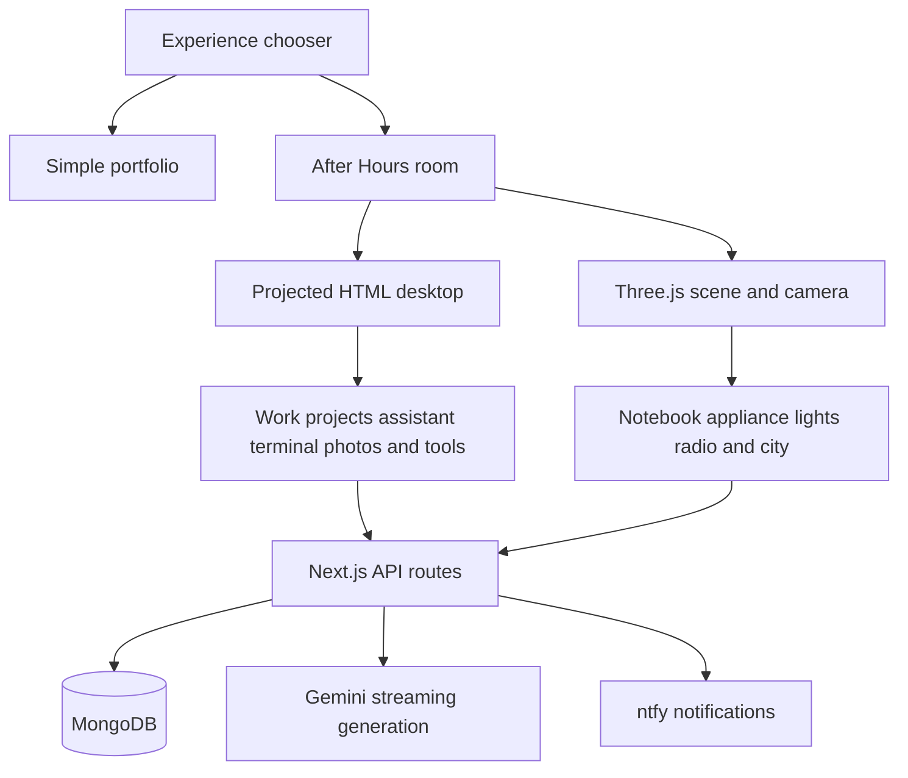
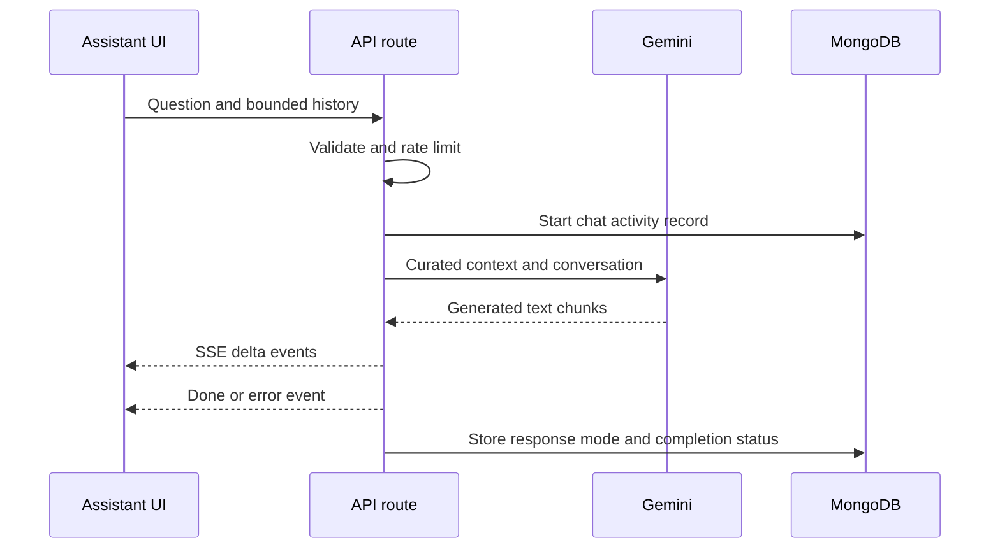

# Portfolio concepts and technical architecture

**Vikram Singh · Technical overview · 7 November 2026**

This portfolio combines a readable professional website with an interactive 3D workspace. Its most distinctive engineering work is the coordination between a Three.js scene, a real HTML desktop, browser input, procedural animation, and server-backed features. The room is an interface to the portfolio: objects lead to work, conversations, drawings, visitor contributions, and small playful interactions.

This document explains the implementation for someone reviewing the project, discussing it in an interview, or extending the code. It describes implemented behavior, explains why the techniques matter, and separates measured results from design intent. Source links point to the relevant files in this repository.

## 1. The product concept

There are two experiences for different visitor needs:

- **Simple** presents work, experience, education, contributions, and contact information in a conventional, readable layout.
- **After Hours** presents a personal workspace that visitors can explore. The monitor contains portfolio applications, the Upliance appliance presents work examples, and the notebook contains technical scratch work and personal doodles.

The landing page makes that choice explicit. Visitors who want information quickly can use Simple; visitors who want to explore can enter the room. This keeps the playful experience from becoming the only route to professional information.

The room also gives interactions a physical meaning. A notebook can be opened and torn, paper can become throwable balls, a radio controls music, a photo frame opens a closer view, and a window leads to a night city. These are connected behaviors rather than isolated hover effects.

**Sources:** [Home](../pages/index.js), [Simple](../pages/simple.js), [After Hours](../pages/after-hours.js), [ProductWorkbench](../components/workbench/ProductWorkbench.js).

## 2. Architecture at a glance

| Layer | Implementation | Responsibility |
| --- | --- | --- |
| Application | Next.js 12 Pages Router and React 18 | Routes, shared providers, UI state, API endpoints |
| Visual styling | CSS Modules and global styles | Responsive layouts, themed cursors, focus states, desktop windows |
| 3D rendering | Three.js and React Three Fiber | Models, cameras, lights, materials, raycasting, animation |
| 2D rendering | HTML, SVG and Canvas 2D | Desktop apps, generated screen textures, notebook artwork, sprites |
| Server data | MongoDB Node driver | Notes, photos, visits, chat activity and admin queries |
| Assistant | Google Generative AI SDK | Streamed answers using curated portfolio context |
| Notifications | Server-side ntfy requests | Best-effort alerts for selected activity |



React coordinates application state and lifecycle. Frame-sensitive work, including camera movement, physics, projection matrices, and material changes, uses refs and frame callbacks instead of updating React state for every rendered frame.

**Sources:** [Dependencies](../package.json), [Application providers](../pages/_app.js), [Scene](../components/workbench/WorkbenchScene.js), [Database connection](../lib/mongodb.js).

## 3. A real desktop inside a 3D monitor

The monitor's desktop is an actual HTML interface, perspective-projected onto a screen in the 3D scene. This is one of the project's most substantial technical details.

The scene converts a desktop coordinate system of 1280 by 780 pixels into the monitor's local screen plane. It then combines the screen's world transform, the camera's inverse world matrix, the projection matrix, and a viewport transform. The resulting matrix is applied to the desktop element through CSS `matrix3d`.

Conceptually:

```text
Desktop pixels
    → monitor local coordinates
    → world coordinates
    → camera coordinates
    → projected viewport coordinates
    → CSS matrix3d
```

As the camera moves, the HTML desktop remains attached to the screen. A cached matrix and viewport size avoid repeating the CSS transform write when the projection has not changed. The implementation also keeps the CSS matrix invertible so browser hit testing continues to work.

This preserves familiar browser capabilities: selectable text, inputs, scrolling, keyboard controls, and React applications. Rebuilding all of those capabilities as 3D meshes would be much more complex.

The HTML desktop is outside the WebGL postprocessing pipeline. Consequently, it has its own approximately one-display-pixel edge mask to soften its perimeter without blurring its contents. The screen projection also determines mobile control sizes, compensating for how large the projected desktop actually appears on the device.

**Why it is interesting:** it joins two rendering systems into one coherent interface, while retaining the strengths of each.

**Sources:** `Monitor` in [WorkbenchScene](../components/workbench/WorkbenchScene.js), [DesktopWorkspace](../components/workbench/DesktopWorkspace.js), [DesktopWindow](../components/workbench/DesktopWindow.js), [Workbench styles](../styles/Workbench.module.css).

## 4. Camera behavior and spatial navigation

The room camera uses OrbitControls for orbiting and zooming. Panning is disabled, and distance, azimuth, and polar-angle limits keep movement within a deliberate range. The general room view targets the original desk-centered point at `[0, 0.2128, -0.51]`.

Opening a notebook, monitor, photo, appliance, note, or city view temporarily changes the camera's position and look target. Transitions interpolate position, target, and field of view. The room position is remembered so leaving a focused object can return to the previous room viewpoint.

Focus distances are calculated from the field of view and viewport aspect ratio. For example, a tall mobile viewport needs a different camera distance to fit a screen or notebook spread. The appliance focus is based on its measured display dimensions and surface normal, so the camera approaches the physical panel rather than an arbitrary location.

While a focused view is active, incompatible orbit controls are disabled. Paper aiming also pauses camera movement. Reduced-motion preferences shorten the experience by applying final states without the usual animated movement.

Browser history participates in this model. A same-URL history entry represents an open focused view; pressing Back first exits that view before leaving the portfolio route.

**Why it is interesting:** navigation state, browser history, responsive composition, and physical camera movement agree about where the visitor is.

**Sources:** `Camera` in [WorkbenchScene](../components/workbench/WorkbenchScene.js), [Focus history](../components/workbench/useFocusHistory.js), [After Hours transition](../components/AfterHoursTransition.js).

## 5. Asset loading follows what visitors need first

The loading strategy gives the initial room screens priority over decorative and secondary artwork.

1. The shared preloader prepares Simple and the After Hours code.
2. The monitor model, appliance model, appliance display, and actual monitor preview textures load first.
3. Other room assets load afterward. Scene readiness waits for the two primary screens before revealing the room through its entry transition.
4. The notebook mounts after those screens are ready and loads the supplied doodle images.
5. The appliance showcase SVGs preload automatically after the room assets and notebook images have settled. They load sequentially with idle scheduling and low image fetch priority, without requiring a visit to the appliance.

Preloading uses the same loader paths and cache keys as the live scene. The home card's progress is based on completed assets, not downloaded bytes. A small image and a large model therefore each count as one completed asset.

The background SVG loader is independent of the appliance's visible work page. Its artwork can become ready before the visitor opens it, but it cannot prevent the appliance's initial model and screen from appearing. Image failures fall back to the text presentation rather than suspending the appliance.

This addresses a common performance mistake: putting every optional texture behind the same loading boundary as the object needed immediately.

**Sources:** [AfterHoursPreload](../components/AfterHoursPreload.js), [PreloadAssets](../components/workbench/PreloadAssets.js), [Upliance](../components/workbench/Upliance.js), [Notebook](../components/workbench/Notebook.js).

## 6. Rendering only the work that changed

### Demand rendering

The scene uses React Three Fiber's `frameloop="demand"`. A new frame is requested when movement or a visual change needs it. Camera damping, active physics, transitions, and other animations continue requesting frames while active; static parts do not need to force a permanent animation loop.

Demand rendering is an optimization opportunity, not a guarantee that the whole room is always idle. An active animation can still keep frames running.

### Cached shadows

Stationary-light shadows are cached. The cache tracks shadow-casting objects, their world transforms, geometry position and index versions, instance transforms, material identity, and relevant light changes. A dirty scene requests a shadow-map refresh; an unchanged scene can reuse the existing result.

This matters because a small visible change can otherwise cause expensive shadow rendering for the rest of the room. The held paper ball is deliberately excluded from shadow casting and receiving while being dragged. Its shadow behavior returns for the thrown ball. The gesture thresholds, launch velocity calculation, and flight simulation remain unchanged.

### Rendering quality

The postprocessing sequence is scene rendering, bloom, output conversion, and SMAA antialiasing. SMAA is enabled after its lookup textures are ready. Existing render targets resize with the viewport instead of rebuilding the entire pipeline. Device pixel ratio is capped at 1.5, limiting the number of pixels processed on high-density screens.

The photo frame uses an additional Canvas 2D technique: a Sobel edge calculation produces a muted outline version of the supplied photo. Focusing the frame fades toward the original color image.

**Sources:** [Shadow cache](../components/workbench/shadowCache.mjs), [StationaryShadows](../components/workbench/StationaryShadows.js), [Paper rendering](../components/workbench/paperRendering.mjs), `NightEffects` in [CityExterior](../components/workbench/CityExterior.js), [PhotoFrame](../components/workbench/PhotoFrame.js).

## 7. Responsive hover without sacrificing precise interaction

An object can contain many meshes. Treating each of them as a hover target creates unnecessary ray intersections and can make the hover state churn as the pointer crosses internal parts.

The room now separates two input paths:

| Input | Picking strategy | Purpose |
| --- | --- | --- |
| Unpressed mouse or pen movement | One cached world-space bounding box for each wrapped interactive object | Stable, inexpensive hover |
| Clicks, pressed movement and captured drags | Existing mesh targets and picking rules | Preserve specific actions and gestures |
| Touch | Existing picking path | Preserve touch interaction behavior |

For ordinary hover, a group-level raycast returns the object as a single target and stops recursive traversal into its children. Existing mesh hitbox optimizations remain available for the other input path, and meshes marked for precise picking, such as the tearable page, retain that behavior.

The same bounds support the outline. Static objects do not rebuild their outline bounds every frame. Moving objects check descendant transforms and geometry versions, updating the box only when those values change. Hover state writes and outline visibility changes are guarded against redundant updates.

The cursor and its rotating glow share one translated DOM layer. There is no independent trailing position for the glow; hovering changes its rotation. The paper-throw overlay uses a native cursor. Touch and reduced-motion users do not receive the animated custom cursor.

**Measured evidence:** a local synthetic benchmark of 5,000 hover picks against a 200-mesh object took approximately 89 ms using the previous per-mesh hitboxes and 1 ms using the group hover path. This is an isolated CPU microbenchmark, not a production FPS or end-to-end latency result. The visitor's observed smoothness is useful feedback, but broader device performance still needs browser profiling.

**Sources:** [Room hover](../components/workbench/roomHover.mjs), [InteractiveObject](../components/workbench/InteractiveObject.js), [Mesh hitboxes](../components/workbench/roomHitboxes.mjs), [ThemeCursor](../components/ThemeCursor.js), [Hover regression tests](../tests/room-hover.test.mjs).

## 8. A notebook with physical continuity

The notebook combines generated scratch-work pages, a tear-instruction page, and four supplied doodle images. Screenshot chrome is cropped at render time, and each doodle fills its leaf with its original ruled or white background. Page edges and scraps use colors chosen to match the source paper.

A canvas texture represents a spread. Left and right textures sample separate halves through texture repetition and offsets. Page turns animate a sheet around the binding; the cover has a separate opening and revisit motion.

Tearing deforms a subdivided plane. The deformation progressively releases the binding edge and lifts the paper as the drag progresses. Each page has a deterministic tear profile with different widths and notches, so its remaining scrap is stable and distinct.

A successful tear:

1. Records the removed leaf.
2. Adds a paper ball to a queue.
3. Keeps the notebook open.
4. Reveals the next surviving sheet when one exists.

Page navigation skips runs of removed leaves. The visual turn still includes their remaining strips together with the surviving sheet, maintaining the sense that those pages once existed. The reverse-page lookup accounts for consecutive tears. When the final visible sheet has been removed, the backing uses the notebook cover's muted green rather than displaying a stale page image.

The notebook's open state and selected page are stored locally. The torn-page list and ball inventory are React state for the current mounted experience; they should not be described as durable cross-device storage.

**Why it is interesting:** the visual model and the interaction state remain consistent across tearing, backward navigation, and multiple missing leaves.

**Sources:** [Notebook](../components/workbench/Notebook.js), [Page data](../components/workbench/notebookPages.js), [Drawing code](../components/workbench/drawNotebook.js), [Paper geometry and navigation](../components/workbench/notebookPaper.mjs), [Notebook tests](../tests/notebook-paper.test.mjs).

## 9. Paper balls and lightweight physics

A torn sheet becomes an inventory item. The visitor selects a ball, drags it in the aiming overlay, and releases a flick. The implementation samples recent pointer movement to calculate a screen-relative velocity, then transforms the launch direction through the camera's orientation into world space.

The flight simulation is custom, lightweight physics rather than a general rigid-body engine. It applies gravity, drag, desk or floor contact, wall bounds, bounce damping, friction, and velocity-based rotation. Bounded substeps reduce tunnelling during slower frames. Balls eventually enter a sleeping state when movement is small enough.

Thrown balls stay mounted, retaining their resting positions. The next inventory item can be used afterward. During aiming, pointer capture keeps the drag connected to the overlay even if the mouse leaves the original ball location.

The drag performance change targets rendering cost: the held ball does not invalidate stationary shadow maps. Once thrown, its normal shadow behavior is restored. This avoids changing the established throwing mechanic to address a rendering problem.

**Sources:** [PaperFlick](../components/workbench/PaperFlick.js), [PaperBalls](../components/workbench/PaperBalls.js), [PaperInventory](../components/workbench/PaperInventory.js), [Shadow regression test](../tests/paper-rendering.test.mjs).

## 10. Upliance as an interactive work presentation

The appliance is an optimized CAD-derived model with preserved semantic parts. Its lid remains a separate assembly, light guides can change emission, and the display is replaced with a controlled screen surface.

Hovering opens the lid and activates the lights and display. Focusing the appliance keeps it awake and presents portfolio work on the physical screen. The work pages combine text and SVG artwork in generated canvas textures. Frame sequences advance after camera arrival, pause their advancement when the document is hidden, and respect reduced motion.

The LED ring uses 56 instances rather than 56 separately managed draw objects. The HTML interaction surface is projected onto the physical display, allowing clicks on either side of the screen to change pages. Keyboard arrows also navigate, and clicking outside or pressing Escape returns to the desk.

The appliance illustrates portfolio work; it is not connected to a live cooking device or recipe backend.

### Model optimization evidence

The asset documentation records a reduction from approximately 1,946,197 triangles to 186,504, about a 90.4% reduction. The interactive GLB is documented as 4,491,216 bytes. Optimization combines compatible parts, simplifies geometry, removes unused data, and quantizes attributes while retaining the nodes needed for animation. It does not require an external runtime decoder.

The city and other room assets also use optimized textures. Color maps use lossy WebP where appropriate; data maps use lossless encoding, and resized normal maps are renormalized. Source files, attribution, and optimization scripts are retained. These are documented asset-pipeline figures, not claims about current network transfer time.

**Sources:** [Upliance](../components/workbench/Upliance.js), [Work content](../components/workbench/uplianceWork.js), [Asset documentation](../public/models/README.md), [Appliance optimizer](../scripts/optimize-upliance.mjs), [City optimizer](../scripts/optimize-city.cjs), [Room optimizer](../scripts/optimize-room.cjs).

## 11. The desktop is a small application environment

The projected desktop has window state, application focus, minimize and close behavior, dragging, resizing, and taskbar controls. Minimized windows retain their component state; closing a window removes it. Mobile layouts use larger controls and different window geometry rather than simply shrinking desktop controls.

The applications include work and project information, an AI assistant, a terminal, photos, task management, and asset credits. External shortcuts open the supplied professional profiles.

The terminal is a browser simulation with a session-only virtual filesystem, command history, completion, path navigation, and supported command parsing. Commands such as `ping` and `sudo` are simulated. It cannot execute host shell commands or access a visitor's files. App listings such as `ps` and `top` reflect open portfolio windows rather than invented operating-system CPU metrics.

The mascot adds stateful feedback: waking, sleeping, walking, exercise, music poses, and hints. Mobile hints are measured with the pixel font and paginated into the available space. They overlay the desktop without resizing the shortcut grid when opened.

**Sources:** [DesktopWorkspace](../components/workbench/DesktopWorkspace.js), [DesktopWindow](../components/workbench/DesktopWindow.js), [Terminal engine](../components/workbench/terminalEngine.mjs), [TaskManager](../components/workbench/TaskManager.js), [DesktopMascot](../components/workbench/DesktopMascot.js), [Mascot behavior](../components/workbench/mascotBehavior.mjs).

## 12. Lighting sound and smaller physical interactions

The hanging light has a simulated rope with connected segments and a moving fixture. Dragging changes its motion, and the simulation can settle to sleep. Instanced cord segments visualize the changing rope without creating a new object for each segment on every frame.

The radio coordinates audio with browser interaction rules. Home entry primes playback directly from the user's click before asynchronous navigation can lose that gesture. The volume then fades in over 11 seconds. A Web Audio gain node is preferred, with a media-element volume fallback. Leaving the room disposes playback resources. Radio clicks also produce a short static effect.

Other interactions include a drawer that reveals wearable glasses, localized lens blur, a city view with a flying aircraft, and generated paper surfaces for notes. These details demonstrate lifecycle management: animations, audio, streams, and event listeners need cleanup as well as startup.

**Sources:** [CeilingLight](../components/workbench/CeilingLight.js), [Radio](../components/workbench/Radio.js), [Radio entrance](../components/workbench/radioEntrance.js), [GlassesDrawer](../components/workbench/GlassesDrawer.js), [GlassesOverlay](../components/workbench/GlassesOverlay.js), [FlyingPlane](../components/workbench/FlyingPlane.js).

## 13. A streamed portfolio assistant

The assistant is available through the website UI and the desktop app. The browser sends a question and a bounded conversation history to `/api/about`. The server combines a system instruction, curated résumé text, and a maintained repository description before requesting streamed generation.



The response uses Server-Sent Events with `delta`, `done`, and `error` messages. The browser reconstructs events across network chunks rather than assuming each network read contains a complete message. Disconnects abort provider work, and timeout handling bounds request lifetime.

If generation fails before any text arrives, the server can provide a labelled curated résumé answer. A failure after partial output produces an interruption message instead of silently replacing the existing reply.

Important implementation limits:

- The endpoint uses curated text context, not a vector database or live repository retrieval.
- Prompt instructions constrain intended behavior but are not a guaranteed security boundary.
- The model identifier can be configured server-side; naming a configured model does not prove provider availability.
- Rate limiting is process-local, not distributed across all server instances.
- The visual assistant-journey replay is illustrative, not live model-internal telemetry.
- The UI conversation is not restored from server history after a reload, even though chat activity is recorded server-side.

**Sources:** [AboutChat](../components/AboutChat.js), [Assistant API](../pages/api/about.js), [Profile knowledge](../lib/profile.js), [Curated context](../lib/assistant-context.js), [Chat activity](../lib/chat-activity.js), [AssistantJourney](../components/AssistantJourney.js).

## 14. Shared notes photos and ownership

### Notes on the wall

Wall notes are real shared data backed by MongoDB. Visitors write text on a projected paper editor, then place it on the room wall. Moving a note intersects the pointer ray with the wall plane and clamps the resulting coordinates to the allowed area.

Ownership uses a browser token whose hash is stored with the record. Read responses expose whether that browser can edit a note, without returning the stored ownership hash. Mutations filter by both note ID and owner hash. Repeated creates use the same ID and insert-only fields, preventing duplicate notes during retries.

This is browser ownership, not a user account system. Clearing the browser token loses those editing rights. Polling refreshes shared state while respecting visibility and editing activity.

### Photos and camera capture

The Photos app supports image selection and browser-camera capture. A captured image is previewed before explicit sharing. Camera tracks are stopped when the relevant view is no longer active. The client produces bounded JPEG images and thumbnails; the server validates encoded size, JPEG structure, and dimensions before storing binary data.

The gallery uses cursor pagination with creation time and ID, returning batches of 40. Browser ownership controls deletion. The API validates requests, bounds writes, and avoids exposing owner hashes in public records.

**Sources:** [StickyNotes](../components/workbench/StickyNotes.js), [Notes hook](../components/workbench/useStickyNotes.js), [Notes API](../pages/api/wall-notes.js), [Photos](../components/workbench/Photos.js), [Photos API](../pages/api/photos.js), [Database connection](../lib/mongodb.js).

## 15. Analytics notifications and the admin boundary

The portfolio tracks semantic interactions, route views, visit duration, and visible-tab active time. Events are batched, and page-exit beacons improve the chance of sending final activity. Server-side records deduplicate batches and merge cumulative durations rather than simply adding every retry.

These metrics have limits: an IP address is not a unique person, visible-tab time is not guaranteed attention, and beacon delivery is not guaranteed. Interaction analytics avoid typed arguments and message contents; chat questions and responses are stored separately as chat activity. The privacy page describes the data practices.

Notifications are server-side, best-effort ntfy requests with a timeout. A notification failure does not turn a successful data write into a failed upload. There is no durable retry queue in the current notification helper.

There is also an authenticated admin data path, separate from simulated terminal privileges. Password verification uses scrypt and constant-time comparison. Sessions use an HMAC-signed, expiring cookie with HttpOnly and SameSite restrictions, and Secure in production. Admin data queries authenticate first, use an allowlist of collections, paginate results, and omit selected large or ownership fields.

This is an important distinction: simulated `sudo` does not grant access to server data. The real admin APIs enforce their own authentication.

**Sources:** [VisitorAnalytics](../components/VisitorAnalytics.js), [Client analytics](../lib/visitor-analytics.js), [Visit API](../pages/api/visit.js), [Notifications](../lib/photo-notifications.js), [Admin authentication](../lib/admin-auth.js), [Admin session API](../pages/api/admin/session.js), [Admin data API](../pages/api/admin/data.js), [Privacy page](../pages/privacy.js).

## 16. Accessibility and responsive interaction

The experience includes keyboard selection for room objects, Enter activation, Escape exits, visible focus treatment, and semantic application controls. Notebook text has a screen-reader representation rather than relying entirely on canvas textures. Hidden or inactive desktop regions use accessibility and interaction attributes to avoid exposing the wrong face or screen as active.

Touch interaction uses its own camera mappings and larger controls. Mobile-only layouts remove keyboard instructions that do not help touch users. Reduced-motion preferences affect camera movement, animation, and custom cursor behavior.

These are implemented accommodations, not evidence of a completed accessibility audit. The spatial room still needs keyboard, screen-reader, contrast, zoom, and mobile-device testing. The Simple experience provides a conventional route to the same professional information.

## 17. Verification and technical claims

The repository contains targeted tests for the virtual terminal, wall-note validation, notebook navigation and tearing, held-paper shadow behavior, and hover picking and bounds caching.

```bash
npm run lint
node --test tests/*.test.mjs
npm run build
```

Lint checks source issues; unit tests exercise specific behavior; a build checks compilation and page generation. None of those alone prove smooth browser rendering or successful production database and provider connections.

The recent hover tests verify that coarse hover avoids child mesh picks while clicks retain their original targets. Bounds tests check idle reuse, movement, geometry deformation, and removed children. The held-paper test verifies that dragging preserves cached shadows and that thrown-paper movement invalidates them again.

For performance validation, compare the same scene, device, viewport, cache state, and interaction before and after a change. Record frame timing and main-thread work during hover and dragging, and inspect network requests during initial loading. The synthetic hover result above should not be presented as a site-wide speedup.

The curated assistant context and older asset notes can lag implementation changes. For current behavior, the component and API source files linked here are the more precise reference.

## 18. Technical details worth highlighting

For a portfolio walkthrough or interview, the strongest explanations connect a constraint to a concrete solution:

1. **A usable desktop inside 3D:** projection matrices attach real HTML apps to a physical monitor while retaining browser input and accessibility features.
2. **Fast hover with precise actions:** separate coarse hover bounds from click and drag picking, rather than reducing precision everywhere.
3. **Rendering with awareness of change:** demand frames and shadow invalidation avoid work that does not affect the current image.
4. **A complete paper interaction:** page deformation, missing-leaf navigation, deterministic scraps, inventory, and physics agree about what happened to each sheet.
5. **An interactive CAD asset:** a large assembly is optimized while preserving meaningful parts for lid, light, and display behavior.
6. **Loading based on perceived importance:** initial screens arrive before secondary art, while optional SVGs still become ready automatically in the background.
7. **Real backend features with explicit boundaries:** shared notes and photos, streamed AI responses, authenticated admin views, and clearly labelled terminal simulation coexist without pretending to be the same kind of capability.
8. **Lifecycle discipline:** textures, geometries, pointer capture, event listeners, timers, audio, camera streams, and provider requests have explicit cleanup paths.

The value of the project is the coordination across these systems. A convincing explanation should show how a visitor action travels through input handling, application state, rendering, and persistence, then explain the tradeoffs made to keep that interaction understandable and responsive.
